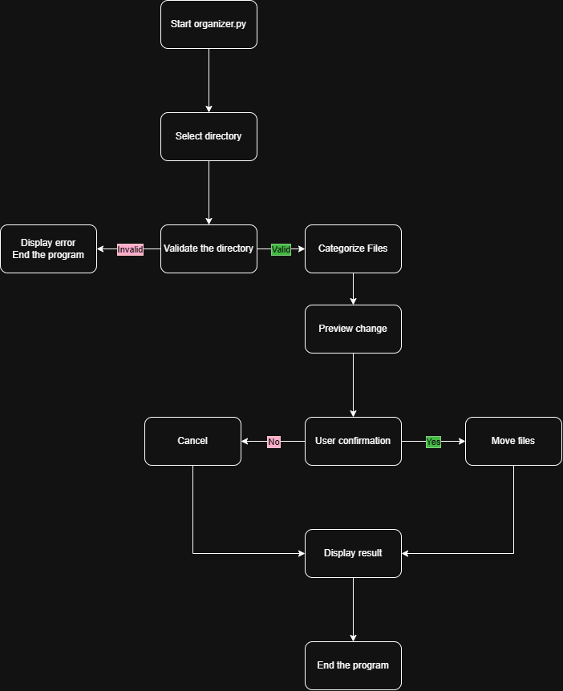

# Smart File Organizer

A Python command-line tool that automatically organizes files into categorized folders based on their file extensions.

## The Problem

Folders such as Downloads often become cluttered with different types of files, including documents, images, videos, and archives. Finding specific files becomes difficult, and manually organizing them takes time and effort.

I built this project to simplify file management by automatically sorting files into appropriate folders while allowing users to preview changes before organizing.

## How It Works

The Smart File Organizer follows these steps:

1. The user selects a directory to organize.
2. The program scans the directory and identifies its files.
3. Each file is categorized based on its extension.
4. The program displays a preview of the proposed file movements.
5. The user confirms or cancels the operation.
6. If confirmed, the program creates category folders and moves the files.
7. The program displays a report of the completed operations.

Files are organized into categories such as:

- **Documents:** `.pdf`, `.docx`, `.txt`
- **Images:** `.jpg`, `.png`, `.gif`
- **Videos:** `.mp4`, `.mov`
- **Music:** `.mp3`, `.wav`
- **Archives:** `.zip`, `.rar`
- **Other:** Files with unrecognized extensions

The program also prevents existing files from being overwritten by generating unique filenames when duplicates are found.

### System Diagram



## Eisenhower Matrix

The following matrix prioritizes project features based on their importance and urgency.

|  | **Urgent** | **Not Urgent** |
|---|---|---|
| **Important** | **DO (MVP)**<br>1. Scan a user-selected directory.<br>2. Categorize files by extension.<br>3. Create category folders and move files.<br>4. Preview planned changes and request user confirmation.<br>5. Prevent overwriting files with duplicate names. | **SCHEDULE (Future Plans)**<br>1. Allow users to customize file categories.<br>2. Add an undo feature to reverse file movements.<br>3. Organize files by creation or modification date.<br>4. Develop a graphical user interface (GUI). |
| **Not Important** | **DELEGATE**<br>1. Use Python's `pathlib` for directory navigation.<br>2. Use Python's `shutil` for moving files.<br>3. Use Python's `logging` module for operation logs.<br>4. Use `unittest` for automated testing. | **DELETE**<br>1. Cloud storage integration.<br>2. AI-powered file content recognition.<br>3. Automatic background organization. |

### Prioritization Explanation

- **DO:** Essential features required for the core functionality of the application.
- **SCHEDULE:** Useful improvements that can be developed after the MVP is completed.
- **DELEGATE:** Existing Python libraries and tools will handle these tasks instead of implementing everything from scratch.
- **DELETE:** Features that add unnecessary complexity and are outside the scope of this project.

## Tech Stack

- **Language:** Python 3
- **Libraries:**
  - `pathlib`: Navigate directories and inspect file paths.
  - `shutil`: Move files between directories.
  - `json`: Store customizable file category settings.
  - `logging`: Record operations and errors.
  - `unittest`: Test program functionality.
- **External Tools:**
  - Git and GitHub: Version control and project hosting.
  - Visual Studio Code: Code editing and development.

## Setup

### Requirements

- Python 3.9 or newer
- Git
- A terminal or command prompt

### Installation

Clone the repository:

```bash
git clone https://github.com/Spes09/file-organizer
cd file-organizer
```

No external Python packages are required for the initial version because the project uses Python's standard library.

## Usage

Run the program from your terminal:

```bash
python organizer.py
```

Follow the instructions to enter the directory you want to organize.

For example, you could enter:

```text
C:\Users\YourName\Downloads
```

The program will scan the directory and display a preview of the proposed file movements. Confirm the operation to begin organizing your files.

**Example result:**

```text
Downloads/
├── Documents/
│   ├── homework.pdf
│   └── notes.docx
├── Images/
│   ├── photo.jpg
│   └── screenshot.png
├── Videos/
│   └── video.mp4
├── Archives/
│   └── project.zip
└── Other/
    └── unknown.xyz
```

## Future Plans

- Customizable file categories and extensions.
- Undo functionality.
- Sorting files by creation or modification date.
- A graphical user interface.

## Project Structure

```text
smart-file-organizer/
├── organizer.py
├── config.json
├── README.md
├── .gitignore
├── docs/
│   ├── eisenhower-matrix.pdf
│   └── diagram.png
└── tests/
    └── test_organizer.py
```

## Author

Khoi Pham